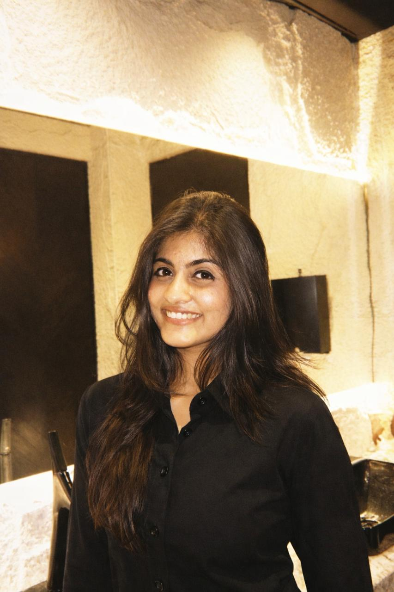

## 

I'm a software engineer in the making who builds across the stack: database schemas, REST APIs, React and Next.js interfaces, and Docker. Right now I'm pointing that foundation at **agentic AI**: systems that plan, call tools, and keep working when a step fails.

I like proof over promises, so here is the short version of what I've done:

- Interned as a **Full Stack Developer at TWWIOS Technologies** (Jul to Sep 2026): backend REST APIs and reusable Next.js components for a production deals app, containerized with Docker.
- Won **1st place at the SynkF Ideathon** with VeilAI (a 12-stage privacy pipeline backed by 172 automated tests) and **3rd place at Oscillation 3.0** among 100+ teams.
- Built an **audit trail across 8 dashboards** (InfraSetu) and **real-time conflict detection across 50+ venues and 3 user roles** (ReserveX).
- Built a **fault-tolerant API layer over 3 forecast models** with caching and request coalescing (AnvayaX).
- **CodeChef 3 stars** · [Find me on LeetCode](https://leetcode.com/u/_palak15/).

Open to software engineering and AI internships, and to collaborating on agent projects.

### Focus areas

| Software engineering | Full stack products | Agentic AI exploration |
|---|---|---|
| REST APIs, data modeling, validation, testing, Docker | React, Next.js, Node.js, React Native, Flutter | Tool use, multi-step workflows, failure recovery, guardrails |

## 

| Practice | Where I've done it | Why it matters for agents |
|---|---|---|
| Graceful degradation | AnvayaX marks a failed model source unavailable while the rest still render | An agent should survive a failed tool call instead of crashing the run |
| Validation and normalization | Internship APIs, AnvayaX data pipeline | Model output and tool arguments must be validated before they are trusted |
| Caching and request coalescing | AnvayaX: 15-minute and 24-hour caches, duplicate-request coalescing | Agents repeat calls; this controls cost and latency |
| Audit trails | InfraSetu: activity and status changes across 8 dashboards | Every agent action should be traceable and reviewable |
| Role-based access control | ReserveX: 3 roles, secure admin operations | Agents need scoped permissions for the tools they can call |
| Automated testing | VeilAI: 172 automated tests across a 12-stage pipeline | Agent behavior needs tests and evals, not just demos |

This is the lens I bring to agentic AI: reliable systems first, clever prompts second.

## 

**Full Stack Development Intern · TWWIOS Technologies (LastMinutesDeals)** 
Jul 2026 to Sep 2026

- Built REST APIs powering deal discovery and listings, with validation, error handling and MongoDB data modeling.
- Created reusable Next.js components used across multiple pages of the production app.
- Containerized services with Docker for consistent development and deployment environments.

## 

<table>
<tr>
<td width="50%" valign="top">

<h3>VeilAI</h3>

AI privacy pipeline · SynkF 1st place

<ul><li>Detects and protects sensitive data.</li><li>Processes data through a 12-stage pipeline.</li><li>Backed by 172 automated tests; won 1st at SynkF.</li></ul>

<code>Privacy</code> <code>Automated testing</code>

<a href="https://github.com/palakk15/VeilAI">Explore repository →</a>
</td>
<td width="50%" valign="top">

<h3>InfraSetu</h3>

Infrastructure management · Traceable workflows

<ul><li>Architected database schemas, backend and REST API integration.</li><li>Built audit trails across 8 dashboards.</li><li>Real-time synchronization reduced manual tracking effort by 40%.</li></ul>

<code>REST APIs</code> <code>Data modeling</code>

<a href="https://github.com/palakk15/infrasetu">Explore repository →</a>
</td>
</tr>
<tr>
<td width="50%" valign="top">

<h3>ReserveX</h3>

Campus logistics · Conflict-free reservations

<ul><li>Automated booking management for 50+ venues and 3 roles.</li><li>Validation and real-time conflict detection prevent duplicate bookings.</li><li>Role-based access and APIs secure reservation and admin workflows.</li></ul>

<code>REST APIs</code> <code>Access control</code>

<a href="https://github.com/palakk15/ReserveX">Repository (private; access required) →</a>
</td>
<td width="50%" valign="top">

<h3>AnvayaX</h3>

AI NWP forecast blending · Resilient APIs

<ul><li>Modular location, forecast and assistant services integrate GFS, IFS and AIFS.</li><li>Timeouts, caching and request coalescing isolate failed model sources.</li><li>Validated data pipelines serve Indian places, PIN codes and island coordinates.</li></ul>

<code>Open-Meteo</code> <code>GeoNames</code>

<a href="https://github.com/palakk15/AnvayaX">Explore repository →</a>
</td>
</tr>
</table>

Project metrics describe different measures, not a shared ranking. The InfraSetu bar shows the reported 40% reduction in manual tracking effort; other segments represent stages, roles or model sources.

## 

- **1st · SynkF Ideathon** — built VeilAI.
- **3rd · Oscillation 3.0 Ideathon** — ideated a healthcare app addressing patient-care gaps, among 100+ teams.
- **3 stars · CodeChef** — [palakk_15](https://www.codechef.com/users/palakk_15).

## 

- Agent architectures: planning, tool use and memory
- Tool calling and MCP servers
- Multi-step workflows with retries and failure recovery
- Evals and guardrails for LLM applications

<!-- TODO: add one real agent project here once built -->

## 

 

| Area | Skills |
|---|---|
| Languages | Java, C, C++, Python, JavaScript, TypeScript, SQL |
| Frameworks & libraries | React, Next.js, React Native, Flutter, Node.js, Express.js, FastAPI, Spring Boot, JWT authentication |
| Tools & web | Git, REST APIs, Docker, MongoDB, VS Code, Jupyter, Eclipse, NPM, Vite, Figma, HTML, CSS |
| Core CS | Data Structures, Object-Oriented Programming, DBMS, Computer Networks, API Integration |

## 

**B.Tech in Computer Engineering · Honors in Data Science** 
Dwarkadas J. Sanghvi College of Engineering (DJSCE), Mumbai 
2024 to 2028 · **CGPA 9.4**

| Community | Role | Period |
|---|---|---|
| Unicode | Technical Committee | Jul 2025 to Jul 2026 |
| DJS Express | Public Speaking Committee | Feb 2025 to Nov 2025 |

## 

<picture>
<source media="(prefers-color-scheme: dark)" srcset="https://raw.githubusercontent.com/palakk15/palakk15/output/github-contribution-grid-snake-dark.svg" />

</picture>

### Let's connect

Happy to talk about software engineering, agentic AI, ideathons and building things that hold up when something breaks.

